# 🏨 Hotel Booking Management System — Complete Project Documentation

> A full-stack web application built with **PHP 8+**, **MySQL (MySQLi)**, **HTML5 / CSS3 / JavaScript**, and **PHPMailer** for end-to-end hotel room discovery, date-based availability checking, online reservations with email confirmation tickets, an interactive hotel assistant chatbot, a full-featured Admin Panel, and an automatic database backup & self-recovery engine.

---

## 📑 Table of Contents

1. [Project Overview & Abstract](#1-project-overview--abstract)
2. [Problem Statement & Objectives](#2-problem-statement--objectives)
3. [Technology Stack](#3-technology-stack)
4. [System Architecture](#4-system-architecture)
5. [Database Design & ER Diagram](#5-database-design--er-diagram)
6. [Project Directory Structure](#6-project-directory-structure)
7. [Application Modules & UI Walkthrough](#7-application-modules--ui-walkthrough)
   - [7.1 Homepage & Destination Search](#71-homepage--destination-search)
   - [7.2 Interactive Hotel Assistant Chatbot](#72-interactive-hotel-assistant-chatbot)
   - [7.3 Room Catalog & Room Details](#73-room-catalog--room-details)
   - [7.4 Real-Time Availability Checker](#74-real-time-availability-checker)
   - [7.5 Room Booking & Instant Ticket + Email Confirmation](#75-room-booking--instant-ticket--email-confirmation)
   - [7.6 User Registration & Authentication](#76-user-registration--authentication)
   - [7.7 Admin Panel & Management Suite](#77-admin-panel--management-suite)
8. [Data Resilience: Auto-Backup & Self-Healing DB](#8-data-resilience-auto-backup--self-healing-db)
9. [Security Measures](#9-security-measures)
10. [Installation & Setup Guide](#10-installation--setup-guide)
11. [Testing & Verification Summary](#11-testing--verification-summary)
12. [Future Enhancements](#12-future-enhancements)

---

## 1. Project Overview & Abstract

Managing hotel room inventory, guest reservations, availability schedules, and revenue manually or in spreadsheets leads to double-bookings, slow customer responses, and poor operational visibility.

The **Hotel Booking Management System** solves this with two tightly integrated portals backed by a relational MySQL database:

- **Guest Portal:** Enables visitors to explore rooms by destination, inspect room capacities and prices, verify live date-range availability, book rooms online without double-booking conflicts, receive instant HTML email tickets via SMTP (PHPMailer), and get quick answers from an embedded interactive Chatbot.
- **Admin Management Panel:** Gives hotel administrators secure role-protected access to KPI dashboards, complete Room CRUD with image uploads, Booking lifecycle management (`Pending` → `Confirmed` → `Completed` / `Cancelled`), Customer directories, date-wise availability lookups, and monthly revenue analytics.

---

## 2. Problem Statement & Objectives

### Problem Statement
Small and mid-sized hotels often struggle with fragmented reservation tracking, manual room availability verification, delayed guest confirmation emails, and risk of local database data loss during server/XAMPP failures.

### Key Objectives
- Eliminate double bookings through SQL date-overlap detection.
- Provide a clean, mobile-responsive interface for guests to discover and book rooms in minutes.
- Automate booking confirmation emails with complete stay details using **PHPMailer**.
- Empower staff with a centralized Admin Dashboard for inventory, reservations, guests, and revenue reporting.
- Ensure zero data loss on local deployments using automated SQL backups and self-healing database recovery.

---

## 3. Technology Stack

| Layer | Technology | Purpose |
| :--- | :--- | :--- |
| **Frontend** | HTML5, CSS3, Vanilla JavaScript | Responsive UI, dynamic forms, interactive Chatbot widget |
| **Backend** | PHP 8.3+ (Procedural + Prepared Statements) | Business logic, sessions, CSRF protection, routing, file uploads |
| **Database** | MySQL / MariaDB (`mysqli` extension) | Relational storage (`users`, `admin_users`, `rooms`, `bookings`) |
| **Email Service** | PHPMailer v7.0 (via Composer) | Automated HTML booking confirmation emails over Gmail SMTP TLS |
| **Configuration** | Custom `.env` Loader (`config/env.php`) | Keeps DB and SMTP credentials isolated from source control |
| **Local Runtime** | XAMPP / PHP Built-in Server + `.bat` Launchers | One-click local startup, phpMyAdmin access, backup & restore |

---

## 4. System Architecture

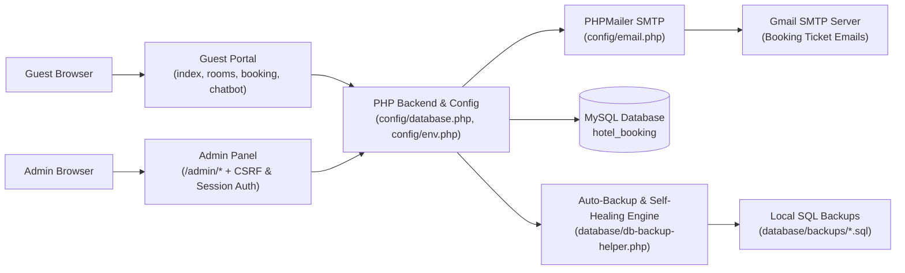

### Request & Booking Lifecycle

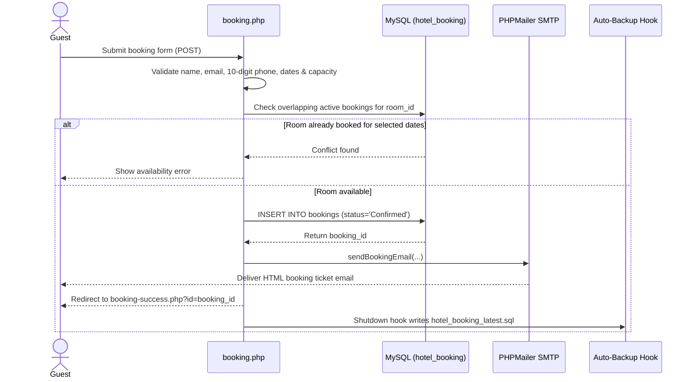

---

## 5. Database Design & ER Diagram

The database `hotel_booking` uses **UTF-8 (`utf8mb4`)** and **InnoDB** with foreign-key constraints across 4 core tables.

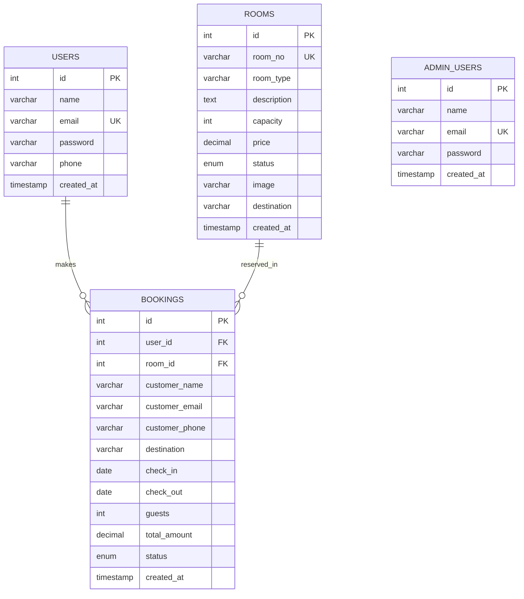

### Table Specifications

#### 1. `rooms`
| Column | Type | Constraints | Description |
| :--- | :--- | :--- | :--- |
| `id` | `INT` | `PRIMARY KEY, AUTO_INCREMENT` | Unique room identifier |
| `room_no` | `VARCHAR(20)` | `NOT NULL, UNIQUE` | Room number (e.g., `101`, `106`) |
| `room_type` | `VARCHAR(100)` | `NOT NULL` | Category (`Single Room`, `Deluxe`, `Suite`, etc.) |
| `description` | `TEXT` | `NULL` | Room amenities and description |
| `capacity` | `INT` | `NOT NULL` | Maximum guests allowed |
| `price` | `DECIMAL(10,2)` | `NOT NULL` | Nightly rate in INR (`₹`) |
| `status` | `ENUM` | `'Available','Unavailable','Booked','Maintenance'` | Current inventory status |
| `image` | `VARCHAR(255)` | `NULL` | Filename stored in `images/` |
| `destination` | `VARCHAR(100)` | `DEFAULT 'Ahmedabad'` | City/location for destination filtering |
| `created_at` | `TIMESTAMP` | `DEFAULT CURRENT_TIMESTAMP` | Record creation timestamp |

#### 2. `bookings`
| Column | Type | Constraints | Description |
| :--- | :--- | :--- | :--- |
| `id` | `INT` | `PRIMARY KEY, AUTO_INCREMENT` | Booking / Ticket ID |
| `user_id` | `INT` | `NULL, FK → users(id) ON DELETE SET NULL` | Optional registered user link |
| `room_id` | `INT` | `NOT NULL, FK → rooms(id) ON DELETE CASCADE` | Booked room reference |
| `customer_name` | `VARCHAR(100)` | `NULL` | Guest full name |
| `customer_email` | `VARCHAR(150)` | `NULL` | Guest email for ticket confirmation |
| `customer_phone` | `VARCHAR(20)` | `NULL` | 10-digit guest phone number |
| `destination` | `VARCHAR(100)` | `NULL` | Selected destination city |
| `check_in` | `DATE` | `NOT NULL` | Check-in date |
| `check_out` | `DATE` | `NOT NULL` | Check-out date |
| `guests` | `INT` | `NOT NULL` | Number of guests |
| `total_amount` | `DECIMAL(10,2)` | `NOT NULL` | Calculated as `nights × room.price` |
| `status` | `ENUM` | `'Pending','Confirmed','Cancelled','Completed'` | Reservation lifecycle status |
| `created_at` | `TIMESTAMP` | `DEFAULT CURRENT_TIMESTAMP` | Booking creation timestamp |

#### 3. `users` & `admin_users`
- **`users`**: Stores registered guests (`id`, `name`, `email` UNIQUE, bcrypt `password`, `phone`, `created_at`).
- **`admin_users`**: Stores separate privileged administrator accounts (`id`, `name`, `email` UNIQUE, bcrypt `password`, `created_at`).

---

## 6. Project Directory Structure

```text
Hotel-Booking/
├── admin/                        # Protected Admin Management Panel
│   ├── includes/
│   │   ├── auth.php              # Session guard, XSS helper e(), flash(), CSRF helpers
│   │   ├── header.php            # Admin sidebar & responsive dashboard layout
│   │   └── footer.php            # Admin layout closing tags
│   ├── login.php                 # Admin authentication page
│   ├── logout.php                # Admin session teardown
│   ├── dashboard.php             # KPI cards (rooms, bookings, customers, revenue) & recent bookings
│   ├── rooms.php                 # Room inventory search, filter & delete
│   ├── add-room.php              # Add new room with validated image upload & destination
│   ├── edit-room.php             # Edit room details & inventory status
│   ├── bookings.php              # Search bookings & update status (Pending/Confirmed/Cancelled/Completed)
│   ├── booking-details.php       # Complete guest & stay breakdown for a booking
│   ├── customers.php             # Aggregated unique customer directory & lifetime booking value
│   ├── availability.php          # Date-range room availability matrix for staff
│   ├── reports.php               # Monthly revenue summary & most popular rooms analytics
│   └── setup_admin.sql           # Admin table SQL schema
│
├── chatbot/                      # Interactive Floating Hotel Assistant
│   ├── chatbot.php               # Widget HTML markup & quick-reply buttons
│   ├── chatbot.css               # Floating widget styles
│   └── chatbot.js                # Intent matching & instant guest Q&A logic
│
├── config/                       # Core Application Configuration
│   ├── env.php                   # Lightweight zero-dependency .env file loader
│   ├── database.php              # MySQLi connection + Auto-Restore + POST Auto-Backup hook
│   └── email.php                 # PHPMailer SMTP HTML booking ticket sender
│
├── database/                     # Schema, Backups & Recovery Scripts
│   ├── hotel-booking.sql         # Master complete SQL schema + seed rooms & default admin
│   ├── db-backup-helper.php      # Portable pure-PHP SQL exporter & importer
│   ├── backup-db.php             # CLI backup runner (latest + 20 rolling snapshots)
│   ├── restore-db.php            # CLI restore runner (supports --if-missing)
│   └── backups/                  # Protected SQL backup directory (.htaccess Deny All)
│
├── docs/screenshots/             # Live UI screenshots embedded in documentation
├── images/                       # Room photography & uploaded room images
├── includes/                     # Shared Guest Header, Footer & Chatbot includes
├── css/ & js/                    # Global guest stylesheets & scripts
│
├── index.php                     # Landing page, hero banner, destination search & room previews
├── rooms.php                     # Full available rooms catalog
├── room-details.php              # Single room detail view
├── check-availability.php        # Live date-overlap & guest-capacity room search
├── booking.php                   # Reservation form, conflict validation, DB insert & email trigger
├── booking-success.php           # Printable/viewable booking confirmation ticket page
├── login.php / register.php / logout.php  # Guest account authentication
│
├── start-project.bat             # One-click launcher (MySQL + Auto-Restore + Website + phpMyAdmin)
├── backup-db.bat                 # One-click manual timestamped DB backup
├── restore-db.bat                # One-click DB restore from latest backup
├── composer.json / composer.lock # PHPMailer dependency manifest
├── .env.example                  # Template for DB & SMTP credentials
└── DOCUMENTATION.md              # This complete project documentation
```

---

## 7. Application Modules & UI Walkthrough

### 7.1 Homepage & Destination Search
**File:** `index.php`

The homepage welcomes visitors with a full-width hero section, quick actions (**Explore Rooms** and **Check Availability**), a **Find Rooms by Destination** search widget (with destination dropdown, check-in, and check-out pickers), hotel highlights, and popular room previews.

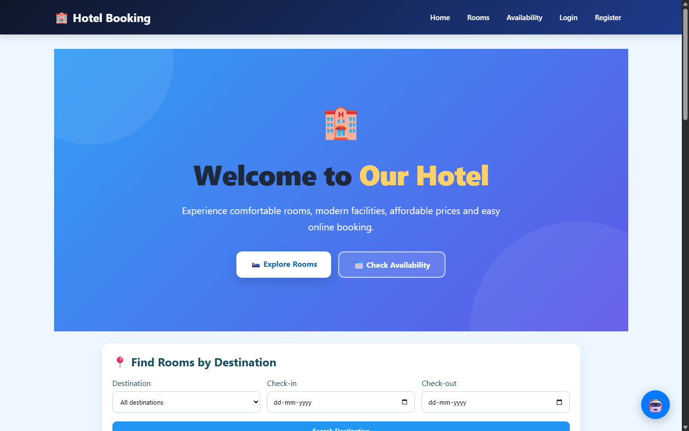

---

### 7.2 Interactive Hotel Assistant Chatbot
**Files:** `chatbot/chatbot.php`, `chatbot/chatbot.js`, `chatbot/chatbot.css`

Available on guest pages as a floating widget in the bottom-right corner. Visitors can type custom questions or tap one-click quick buttons (**Available Rooms**, **How to Book?**, **Room Prices**) to get instant guidance without waiting for staff.

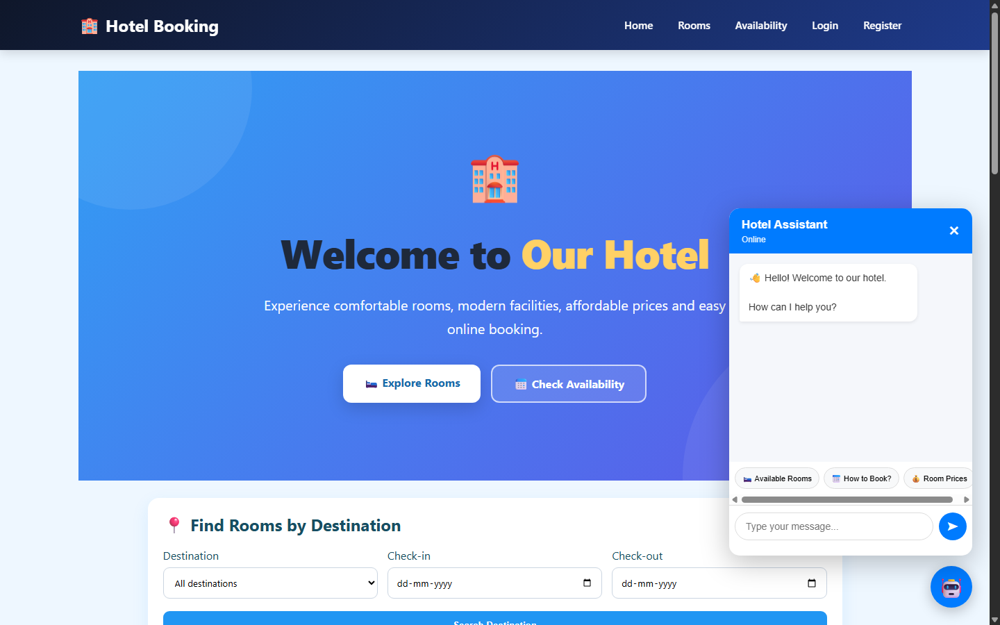

---

### 7.3 Room Catalog & Room Details
**Files:** `rooms.php`, `room-details.php`

- **Room Catalog (`rooms.php`)**: Dynamically queries all `Available` rooms from MySQL and displays them in a responsive card grid with room photography, room number, description, guest capacity, nightly price in INR (`₹`), and a **View Details** button.
- **Room Details (`room-details.php`)**: Displays full specifications for the chosen room and links directly into the booking flow.

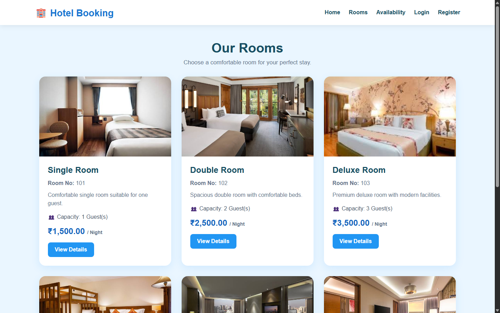

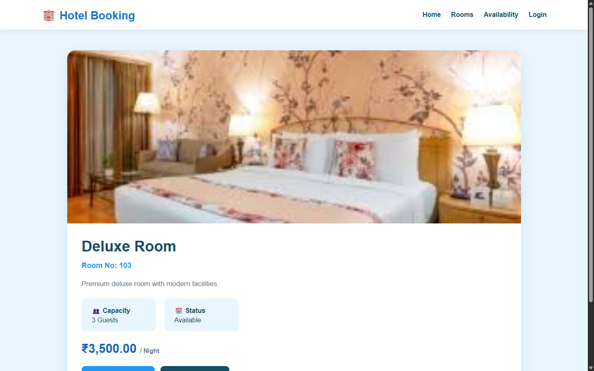

---

### 7.4 Real-Time Availability Checker
**File:** `check-availability.php`

Allows guests to enter **Check-in Date**, **Check-out Date**, and **Number of Guests** to find rooms with zero scheduling conflicts.

**Overlap Prevention SQL Logic:**
```sql
SELECT * FROM rooms
WHERE capacity >= ?
  AND status = 'Available'
  AND id NOT IN (
      SELECT room_id
      FROM bookings
      WHERE check_in < ?   -- requested check_out
        AND check_out > ?  -- requested check_in
  )
ORDER BY price ASC;
```
Any room whose existing booking overlaps the requested stay window is automatically excluded.

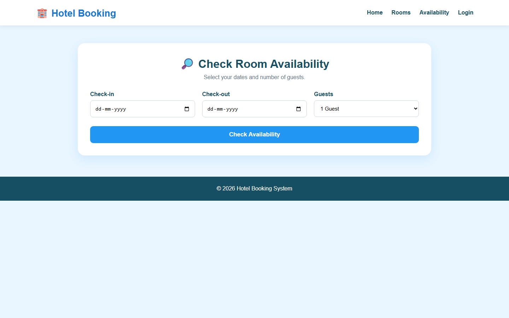

---

### 7.5 Room Booking & Instant Ticket + Email Confirmation
**Files:** `booking.php`, `booking-success.php`, `config/email.php`

1. Displays selected room details (room number, capacity, nightly rate).
2. Validates guest full name, valid email address, 10-digit phone number, destination city, check-in/check-out dates, and guest count against room capacity.
3. Re-checks date overlap at submission time to prevent race-condition double bookings.
4. Automatically calculates stay duration (`nights`) and `total_amount = nights × room.price`.
5. Saves the reservation to `bookings`, triggers **PHPMailer** to send a formatted HTML confirmation ticket to the guest's email, and redirects to the live confirmation ticket page (`booking-success.php`).

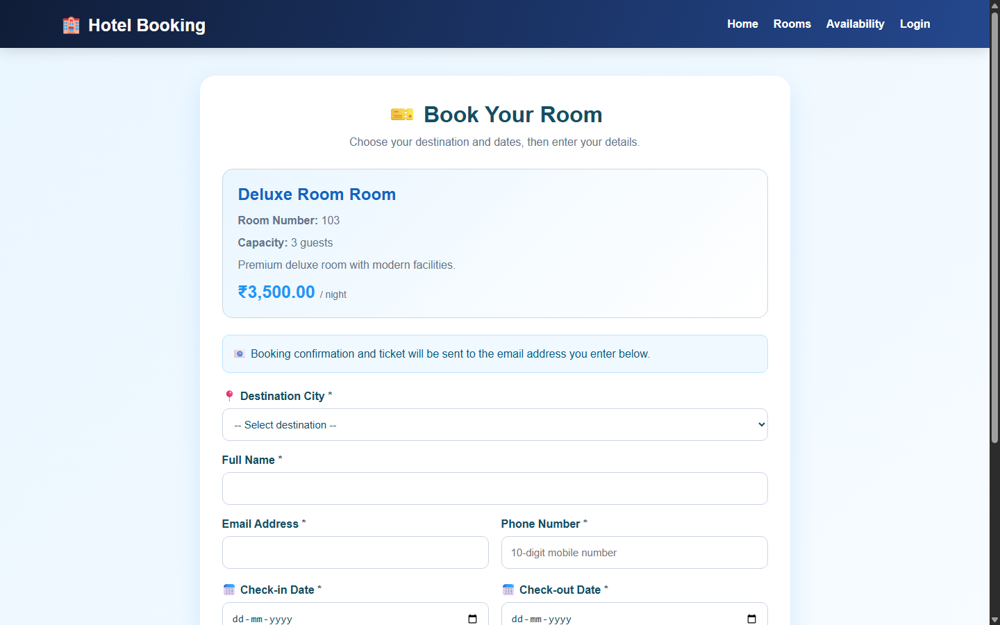

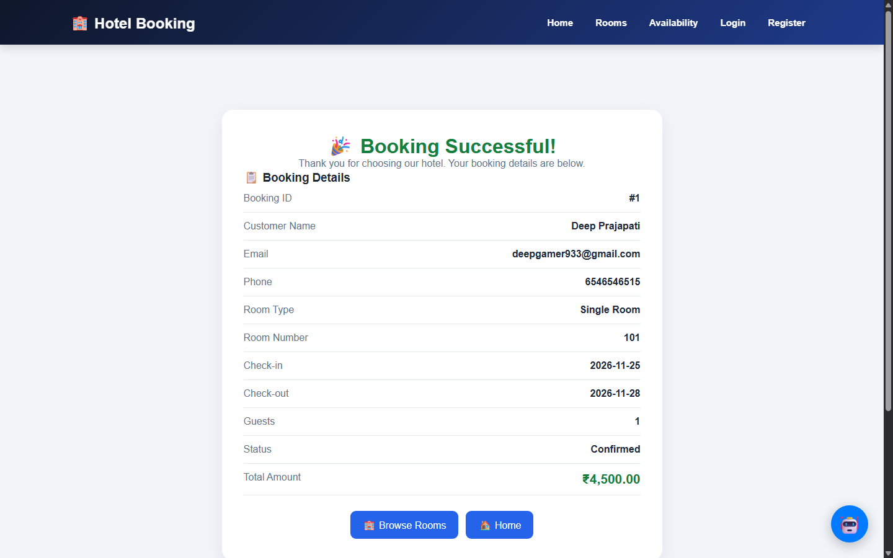

---

### 7.6 User Registration & Authentication
**Files:** `register.php`, `login.php`, `logout.php`

- **Registration**: Validates required fields, email format, uniqueness, minimum 6-character password length, and password confirmation; hashes passwords securely using PHP's `password_hash(..., PASSWORD_DEFAULT)`.
- **Login**: Authenticates against `users` with `password_verify()`, initializes PHP sessions, and supports post-login redirect back to the requested page.

---

### 7.7 Admin Panel & Management Suite
**Directory:** `admin/`

#### Admin Login (`admin/login.php`)
Dedicated administrator authentication backed by `admin_users` with `session_regenerate_id(true)` on successful sign-in to prevent session fixation.

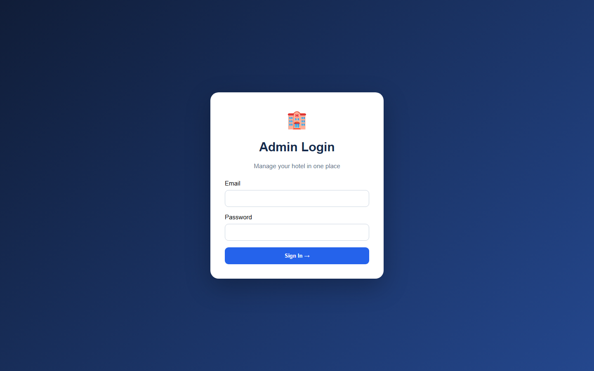

#### Admin Dashboard (`admin/dashboard.php`)
Displays real-time KPIs at a glance:
- **Total Rooms** & **Available Rooms**
- **Total Bookings** & **Pending Bookings**
- **Unique Customers** (by distinct guest email)
- **Confirmed Revenue** (`SUM(total_amount)` across `Confirmed` & `Completed` bookings)
- **Recent Bookings Table** with quick **Details** navigation

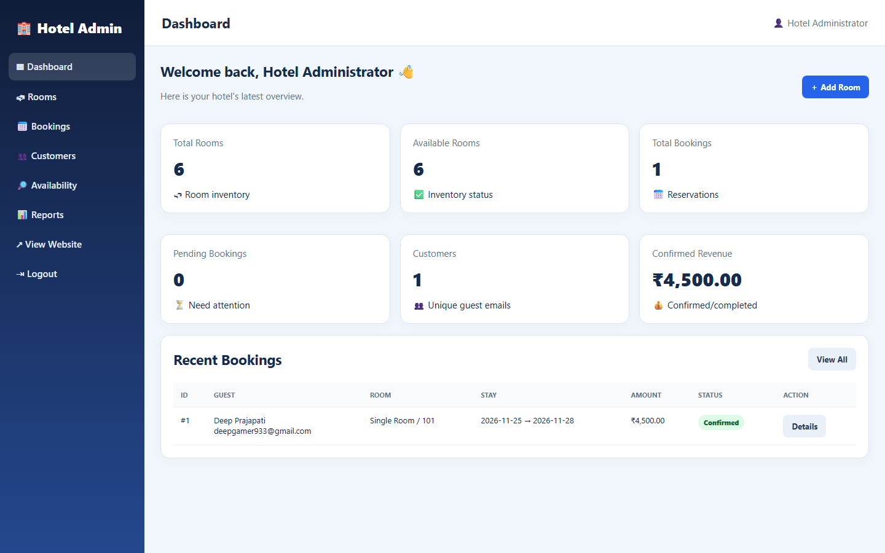

#### Room Inventory Management (`admin/rooms.php`, `admin/add-room.php`, `admin/edit-room.php`)
- Search rooms by room number, city, or type; filter by **Destination**, **Room Type**, and **Status** (`Available`, `Booked`, `Maintenance`).
- Add new rooms with image file upload validation (extension & MIME check) and destination assignment.
- Edit room attributes or delete rooms with CSRF-protected forms.

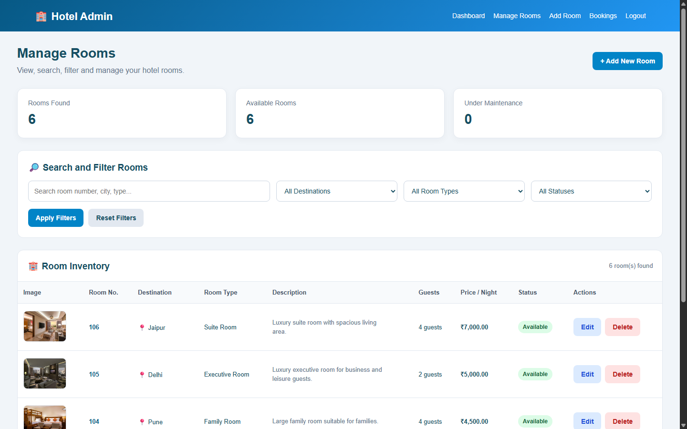

#### Bookings, Customers, Availability & Reports
- **`admin/bookings.php` & `admin/booking-details.php`**: Search reservations by ID/name/email/phone and update status (`Pending`, `Confirmed`, `Cancelled`, `Completed`).
- **`admin/customers.php`**: Aggregated guest directory showing total bookings, total booking value, and latest booking per unique email.
- **`admin/availability.php`**: Staff calendar view showing each room's live status (`Available`, `Booked`, or `Maintenance`) for any selected date range.
- **`admin/reports.php`**: Executive overview of all/confirmed/cancelled bookings, total confirmed revenue, 6-month **Monthly Booking Summary**, and **Most Booked Rooms** leaderboard.

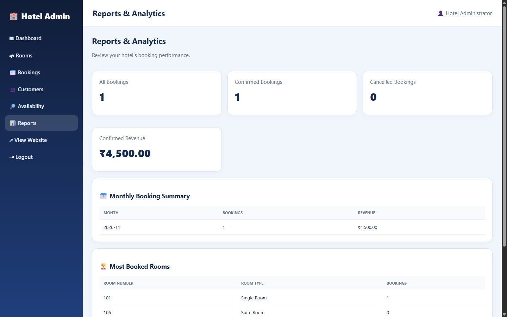

---

## 8. Data Resilience: Auto-Backup & Self-Healing DB

To ensure the project and database survive local XAMPP crashes, corruption, or machine migrations, a pure-PHP backup & recovery layer is built directly into the codebase:

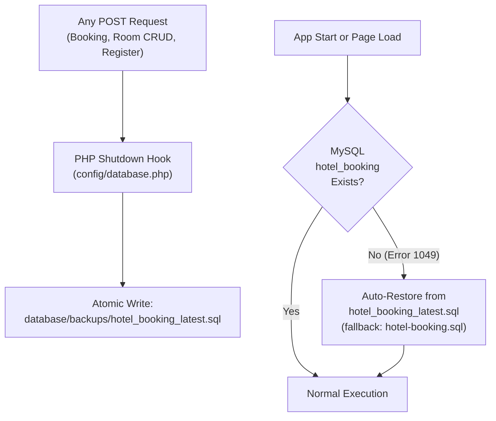

- **Silent Auto-Backup**: After every `POST` request, `config/database.php` atomically refreshes `database/backups/hotel_booking_latest.sql` (using a `.tmp` file + `rename` so files can never be half-written).
- **Self-Healing Auto-Recovery**: If MySQL throws `1049 Unknown database 'hotel_booking'` (e.g., after reinstalling XAMPP), `config/database.php` automatically recreates the database and imports the latest backup transparently.
- **One-Click Batch Utilities**:
  - `start-project.bat` — Starts MySQL, verifies/auto-restores DB, launches Website (`:8000`) & phpMyAdmin (`:8080`).
  - `backup-db.bat` — Creates a timestamped snapshot in `database/backups/` (retains latest 20 snapshots automatically).
  - `restore-db.bat` — Restores the database from `hotel_booking_latest.sql` on any fresh MySQL server.

---

## 9. Security Measures

| Threat / Area | Protection Implemented |
| :--- | :--- |
| **SQL Injection** | Parameterized `mysqli` prepared statements (`prepare` + `bind_param`) across queries |
| **Cross-Site Scripting (XSS)** | Output escaping via `htmlspecialchars(..., ENT_QUOTES, 'UTF-8')` / `e()` helper |
| **Cross-Site Request Forgery (CSRF)** | Cryptographic tokens (`bin2hex(random_bytes(32))`) verified with `hash_equals()` in admin forms |
| **Password Storage** | Bcrypt hashing with `password_hash()` and verification via `password_verify()` |
| **Session Hijacking / Fixation** | `session_regenerate_id(true)` on admin login & session auth guard in `admin/includes/auth.php` |
| **Secret Exposure** | `.env` file excluded via `.gitignore`; `config/email.php` & `config/database.php` read via `getenv()` |
| **Direct Backup Download** | `database/backups/.htaccess` blocks all HTTP access to SQL backup dumps |

> **Production Note:** Before deploying publicly, remove or restrict utility scripts (`reset-admin.php`, `test-db.php`, `generate-password.php`) and change the default admin password.

---

## 10. Installation & Setup Guide

### Prerequisites
- **PHP 8.0+** with `mysqli` extension enabled
- **MySQL 5.7+ / MariaDB 10.4+** (bundled in XAMPP / Laragon / WAMP)
- **Composer** (to install PHPMailer)

### Step-by-Step Setup

1. **Clone the repository:**
   ```bash
   git clone https://github.com/rushisable05/Hotel-Booking.git
   cd Hotel-Booking
   ```

2. **Install PHP dependencies:**
   ```bash
   composer install
   ```

3. **Configure environment variables:**
   Copy `.env.example` to `.env` and fill in your credentials:
   ```bash
   copy .env.example .env
   ```

   | Variable | Default | Description |
   | :--- | :--- | :--- |
   | `DB_HOST` | `localhost` | MySQL host |
   | `DB_USER` | `root` | MySQL username |
   | `DB_PASS` | *(empty)* | MySQL password |
   | `DB_NAME` | `hotel_booking` | Database name |
   | `SMTP_HOST` | `smtp.gmail.com` | SMTP server host |
   | `SMTP_PORT` | `587` | SMTP TLS port |
   | `SMTP_USER` | *(your email)* | Sender email address |
   | `SMTP_PASS` | *(app password)* | Gmail App Password |
   | `SMTP_FROM_NAME` | `Hotel Booking System` | Email sender display name |

4. **Launch the application:**
   - **Windows One-Click:** Double-click `start-project.bat`
   - **Manual CLI:** Start MySQL, then run:
     ```bash
     php -S localhost:8000
     ```
     *(The database `hotel_booking` will auto-initialize from `database/hotel-booking.sql` on first visit.)*

5. **Access URLs & Default Admin Credentials:**
   - **Guest Website:** `http://localhost:8000`
   - **Admin Panel:** `http://localhost:8000/admin/login.php`
   - **phpMyAdmin (via `start-project.bat`):** `http://localhost:8080`
   - **Default Admin:** `admin@example.com` / `Rushi123`

---

## 11. Testing & Verification Summary

| Test Case | Endpoint / Action | Result |
| :--- | :--- | :--- |
| PHP Syntax Lint | All 32+ project `.php` files (`php -l`) | ✅ 0 syntax errors |
| Database Connection | `/test-db.php` | ✅ `200 OK` — Connected |
| Guest Portal Pages | `/`, `/rooms.php`, `/room-details.php`, `/booking.php`, `/check-availability.php`, `/login.php`, `/register.php` | ✅ All `200 OK`, 0 PHP warnings |
| End-to-End Booking | Create booking + confirmation ticket (`/booking-success.php?id=1`) | ✅ Saved in DB & ticket rendered |
| Admin Auth & Pages | Login → `/admin/dashboard.php`, `/admin/rooms.php`, `/admin/bookings.php`, `/admin/customers.php`, `/admin/availability.php`, `/admin/reports.php`, `/admin/add-room.php` | ✅ All `200 OK`, 0 PHP warnings |
| Disaster Recovery | `DROP DATABASE hotel_booking` → visit `/rooms.php` | ✅ Auto-restored all 4 tables & data |
| Silent Auto-Backup | Submit `POST` request → inspect `database/backups/hotel_booking_latest.sql` | ✅ Updated automatically |

---

## 12. Future Enhancements

- **Online Payment Gateway Integration** (Razorpay / Stripe) with payment status tracking.
- **Downloadable PDF Booking Invoices** generated on `booking-success.php`.
- **Guest Dashboard ("My Bookings")** allowing logged-in users to view history and request cancellations.
- **Room Reviews & Star Ratings** from verified completed stays.
- **Multi-Admin Roles & Audit Logs** (Manager vs. Receptionist permissions).
- **Cloud Deployment** using Docker or Railway/Render with managed Cloud MySQL.
