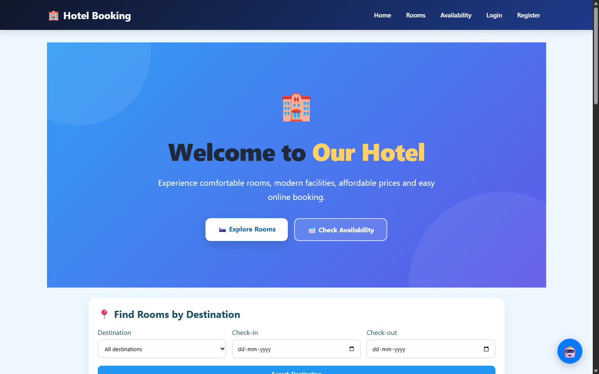
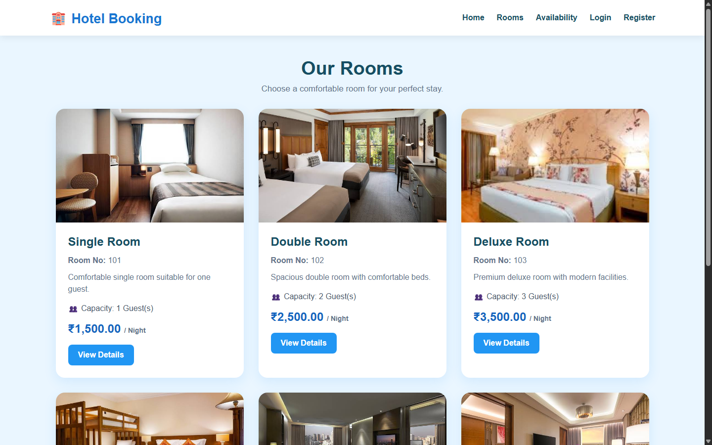
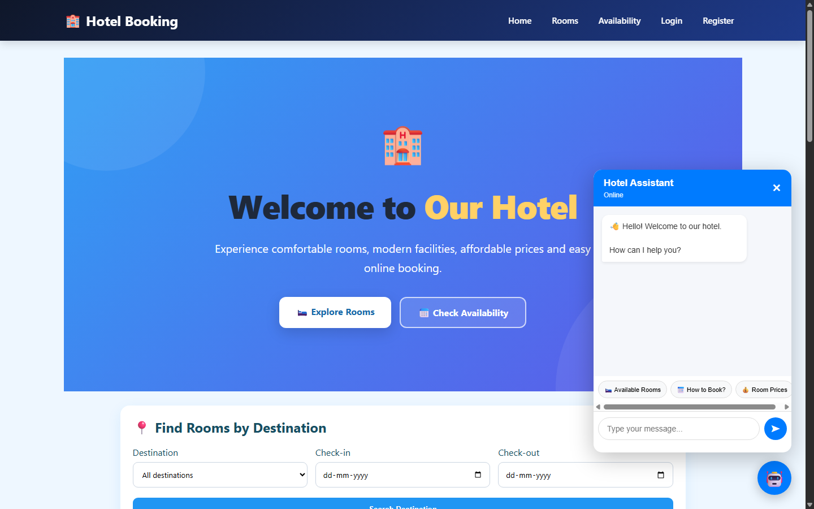
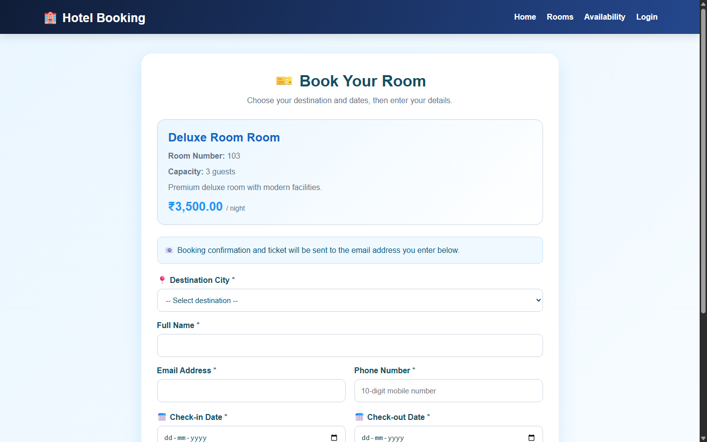
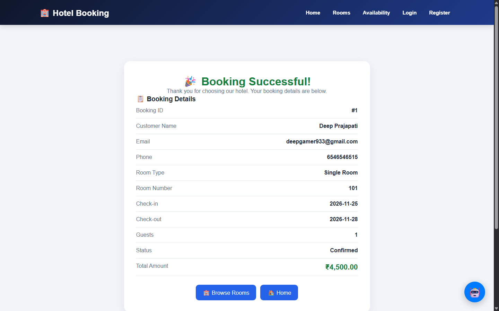
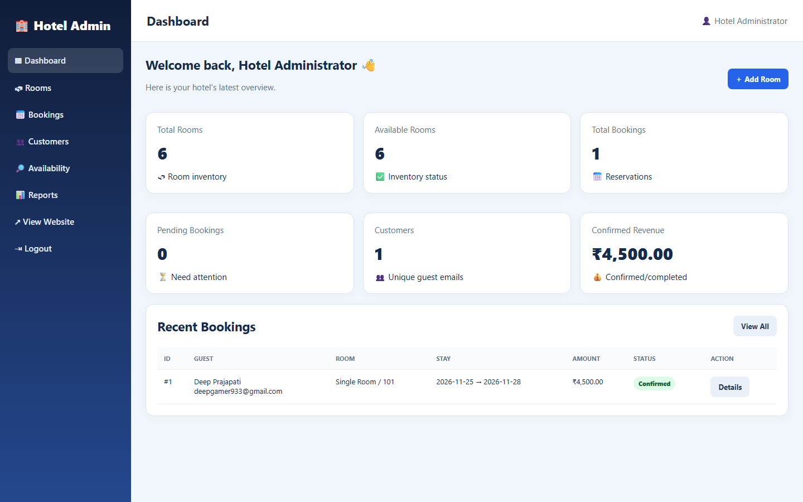
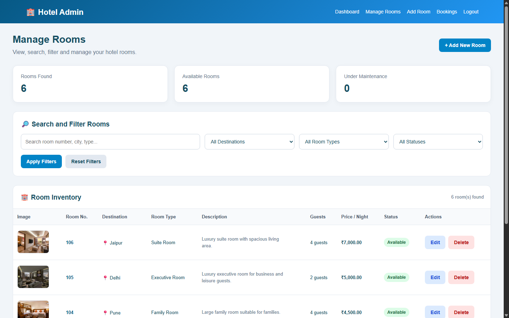

# 🏨 Hotel Booking Management System


A complete **Hotel Booking & Management System** built with **PHP & MySQL**, featuring a guest booking portal, real-time date availability checker, automated SMTP email confirmation tickets, an interactive hotel assistant chatbot, a full Admin Panel with analytics, and an automatic database backup & self-recovery engine.

> 📖 **Looking for the full technical report, ER diagrams, architecture flowcharts, security breakdown, and module-by-module guide?**  
> 👉 Read the **[Complete Project Documentation (`DOCUMENTATION.md`)](DOCUMENTATION.md)**

---

## 📸 Screenshots Preview

### Guest Homepage & Destination Search


### Rooms Catalog & Interactive Chatbot
| Rooms Catalog | Hotel Assistant Chatbot |
| :---: | :---: |
|  |  |

### Online Booking & Confirmation Ticket
| Room Booking Form | Booking Confirmation Ticket |
| :---: | :---: |
|  |  |

### Admin Dashboard & Room Inventory
| Admin Dashboard | Manage Rooms |
| :---: | :---: |
|  |  |

*(See all 11 screenshots including Room Details, Availability Checker, Admin Login & Analytics Reports inside [DOCUMENTATION.md](DOCUMENTATION.md).)*

---

## ✨ Key Highlights

- **Guest Booking Portal:** Destination search, room catalog with photography, date-overlap availability checker, online booking form, and instant booking ticket page.
- **Automated Email Tickets:** Sends formatted HTML booking confirmations using **PHPMailer** via Gmail SMTP (configured safely via `.env`).
- **Built-in Hotel Assistant Chatbot:** Floating interactive assistant with quick-reply buttons for rooms, pricing, and booking guidance.
- **Full Admin Panel (`/admin/login.php`):** KPI Dashboard, Room CRUD with image uploads, Booking status management, Customer Directory, Date Availability Matrix, and Revenue Reports.
- **Auto-Backup & Self-Healing Database:** Automatically backs up MySQL data on writes and auto-restores `hotel_booking` if XAMPP crashes or gets reinstalled.
- **Security First:** Prepared SQL statements, bcrypt password hashing, CSRF protection, XSS escaping, and `.env` secret isolation.

---

## 🚀 Quick Start (Local)

```bash
# 1. Clone the repository
git clone https://github.com/rushisable05/Hotel-Booking.git
cd Hotel-Booking

# 2. Install Composer dependencies (PHPMailer)
composer install

# 3. Configure environment credentials
copy .env.example .env
```

- **Windows One-Click Launch:** Double-click **`start-project.bat`** (starts MySQL, auto-initializes/restores the DB, launches the website on `http://localhost:8000` and phpMyAdmin on `http://localhost:8080`).
- **Manual Launch:** Start MySQL and run `php -S localhost:8000`.

### 🔐 Default Admin Login
- **URL:** `http://localhost:8000/admin/login.php`
- **Email:** `admin@example.com`
- **Password:** `Rushi123`

---

## 📂 Documentation & Utilities

| File | Description |
| :--- | :--- |
| [`DOCUMENTATION.md`](DOCUMENTATION.md) | Complete project documentation with architecture, ER diagrams, screenshots & testing report |
| [`database/hotel-booking.sql`](database/hotel-booking.sql) | Complete MySQL schema with sample rooms & default admin |
| [`start-project.bat`](start-project.bat) | One-click launcher for MySQL, auto DB recovery, Website & phpMyAdmin |
| [`backup-db.bat`](backup-db.bat) | Create a timestamped database backup snapshot |
| [`restore-db.bat`](restore-db.bat) | Restore database on a fresh XAMPP / MySQL installation |
